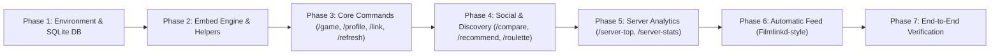

# Backloggd Discord Bot — Implementation Plan (Native Discord Embeds Architecture)

This document outlines the architecture, data models, UI embed systems, command specifications, and phased implementation milestones for the Backloggd Discord bot using **Native Discord Embeds and UI Components**.

---

## 1. System Architecture & Tech Stack

```mermaid
flowchart TD
    subgraph Discord["Discord Client"]
        SlashCmd["Slash Commands (/game, /profile, /compare, /recommend, /roulette, /server-top, /server-stats, /link, /refresh, /setchannel)"]
        AutoComplete["Live Autocomplete (typing in /game)"]
        FeedChannel["#game-logs Channel (Auto Feed)"]
        UIButtons["Interactive UI Buttons (Reroll, Backloggd Link, Refresh)"]
    end

    subgraph Bot["Bot Core (discord.py v2)"]
        Client["BackloggdBot (commands.Bot)"]
        TasksLoop["Feed Poller (discord.ext.tasks)"]
        
        subgraph Cogs["Cogs"]
            GameCog["GamesCog (/game)"]
            UserCog["UsersCog (/profile)"]
            SocialCog["SocialCog (/compare)"]
            DiscoveryCog["DiscoveryCog (/recommend, /roulette)"]
            StatsCog["StatsCog (/server-top, /server-stats)"]
            AccountCog["AccountCog (/link, /unlink, /refresh)"]
            FeedCog["FeedCog (/setchannel, /unsetchannel)"]
        end
        
        EmbedEngine["Embed & Component Builder (discord.Embed & discord.ui.View)"]
        DB["Async SQLite (aiosqlite)"]
    end

    subgraph Backloggd["Backloggd Web"]
        BackloggdAPI["BackloggdClient (backloggd-py)"]
    end

    SlashCmd --> Cogs
    UIButtons --> Cogs
    AutoComplete --> GameCog
    GameCog --> BackloggdAPI
    GameCog --> DB
    GameCog --> EmbedEngine
    EmbedEngine --> SlashCmd
    
    SocialCog --> BackloggdAPI
    SocialCog --> EmbedEngine
    DiscoveryCog --> DB
    DiscoveryCog --> BackloggdAPI
    DiscoveryCog --> EmbedEngine
    StatsCog --> DB
    StatsCog --> EmbedEngine
    
    TasksLoop --> BackloggdAPI
    TasksLoop --> DB
    TasksLoop --> FeedChannel
```



### Advantages of Native Discord Embeds
- **Near-Zero Resource Footprint**: Idles at ~25–40MB RAM, ideal for 100% free hosting tiers (Render, Fly.io, Railway, Oracle Free VM).
- **Instant Response Times**: Embeds construct in $<5\text{ms}$ with zero image processing overhead.
- **Flawless Mobile Responsiveness**: Adapts dynamically to iOS, Android, and desktop screens with native Discord typography.
- **Interactive Buttons**: Seamless integration with clickable links, reroll buttons, and select menus.

### Dependencies
- **`discord.py` (v2.x)**: Bot framework with slash commands, autocomplete, embeds, and background tasks.
- **`backloggd-py`**: Async client (`BackloggdClient`) for scraping game data, user libraries, profiles, similarity algorithms, and journals.
- **`aiosqlite`**: Non-blocking SQLite driver for account links, cached ratings, and leaderboard queries.
- **`python-dotenv`**: Environment variable management (`DISCORD_TOKEN`, `DEV_GUILD_ID`).

---

## 2. Database Schema (`bot/db.py`)

```sql
-- 1. Linked user mapping
CREATE TABLE IF NOT EXISTS linked_users (
    discord_id INTEGER PRIMARY KEY,
    backloggd_username TEXT NOT NULL UNIQUE,
    avatar_url TEXT,
    last_synced_at TIMESTAMP DEFAULT CURRENT_TIMESTAMP
);

-- 2. Cached game metadata
CREATE TABLE IF NOT EXISTS cached_games (
    slug TEXT PRIMARY KEY,
    title TEXT NOT NULL,
    cover_url TEXT,
    release_year INTEGER,
    community_rating REAL
);

-- 3. Cached game ratings for instant server score queries & leaderboards
CREATE TABLE IF NOT EXISTS user_ratings (
    discord_id INTEGER NOT NULL,
    game_slug TEXT NOT NULL,
    rating REAL,              -- e.g. 4.5, NULL if unrated
    status TEXT NOT NULL,      -- 'played', 'playing', 'backlog', 'wishlist'
    is_liked BOOLEAN DEFAULT 0,
    updated_at TIMESTAMP DEFAULT CURRENT_TIMESTAMP,
    PRIMARY KEY (discord_id, game_slug),
    FOREIGN KEY (discord_id) REFERENCES linked_users (discord_id) ON DELETE CASCADE,
    FOREIGN KEY (game_slug) REFERENCES cached_games (slug) ON DELETE CASCADE
);

CREATE INDEX IF NOT EXISTS idx_ratings_slug ON user_ratings(game_slug);
CREATE INDEX IF NOT EXISTS idx_ratings_user ON user_ratings(discord_id);
CREATE INDEX IF NOT EXISTS idx_ratings_status ON user_ratings(status);

-- 4. Server feed channel configuration
CREATE TABLE IF NOT EXISTS guild_settings (
    guild_id INTEGER PRIMARY KEY,
    feed_channel_id INTEGER NOT NULL
);

-- 5. Deduplication table for automatic journal feeds
CREATE TABLE IF NOT EXISTS seen_journal_logs (
    entry_id TEXT PRIMARY KEY,
    discord_id INTEGER NOT NULL,
    posted_at TIMESTAMP DEFAULT CURRENT_TIMESTAMP
);
```

---

## 3. Project File Structure

```text
backloggd-dc/
├── bot/
│   ├── __init__.py
│   ├── client.py               # Custom commands.Bot with BackloggdClient lifecycle
│   ├── config.py               # Settings (colors, constants, env vars)
│   ├── db.py                   # Async SQLite database interface & migrations
│   ├── ui/                     # Discord Embeds & UI Components
│   │   ├── __init__.py
│   │   ├── embeds.py           # Embed constructors (game, profile, compare, roulette)
│   │   ├── views.py            # Discord UI Buttons (Reroll, Link buttons)
│   │   └── helpers.py          # Star rating formatters (★★★★½), status emojis
│   └── cogs/
│       ├── games.py            # /game with live autocomplete & embed output
│       ├── users.py            # /profile embed command
│       ├── social.py           # /compare command
│       ├── discovery.py        # /recommend & /roulette (with Reroll button UI)
│       ├── stats.py            # /server-top (with specialty modes) & /server-stats
│       ├── account.py          # /link, /unlink, /refresh commands
│       └── feed.py             # /setchannel, /unsetchannel & background poller
├── .env.example                # Config template
├── requirements.txt            # Package list
├── implementation_plan.md      # Project plan & specification
└── main.py                     # Entrypoint & startup script
```

---

## 4. UI / Embed Specifications

All embeds use Backloggd's dark theme palette via hex colors:
- **Default / Game**: `#8E61F2` (Backloggd Violet)
- **High Rating / Match**: `#F5A623` (Golden Amber)
- **Played**: `#10C47E` (Emerald Green)
- **Playing**: `#3B82F6` (Electric Blue)
- **Wishlist**: `#EC4899` (Pink)

### Embed A: `/game <title>`
- **Title**: `[Title] ([Year])` (hyperlinked to Backloggd page)
- **Thumbnail**: Game cover art URL
- **Description**:
  - `FromSoftware • Bandai Namco`
  - `Genres: Action RPG, Open World, Souls-like`
  - `Community Rating: ★★★★½ 4.5 / 5.0 (142.4k ratings)`
- **Fields**:
  - `Global Stats`: `🎮 98.4k Played • ▶️ 14.2k Playing • ⏳ 62.1k Backlog • 💖 35.8k Wishlist`
  - `Server Member Ratings`:
    ```
    • Nox: ★★★★★ (5.0) — Played
    • Kaelen: ★★★★½ (4.5) — Played
    • Vesper: ★★★★☆ (4.0) — Playing
    • Arlo: ⏳ In Backlog
    ```
- **Components**: `[ 🌐 View on Backloggd ]` URL button.

### Embed B: `/profile [user]`
- **Title**: `[Username] on Backloggd`
- **Thumbnail**: User avatar URL
- **Description**: Bio quote + profile URL
- **Fields**:
  - `Stats`: `🎮 342 Played  •  ▶️ 3 Playing  •  ⏳ 118 Backlog  •  💖 45 Wishlist`
  - `Average Rating`: `⭐ 4.12 / 5.0`
  - `Favorite Games`:
    - `1. Bloodborne (★ 5.0)`
    - `2. Chrono Trigger (★ 5.0)`
    - `3. Hollow Knight (★ 5.0)`
    - `4. Outer Wilds (★ 5.0)`
- **Components**: `[ 🌐 View Profile ]` URL button.

### Embed C: `/compare <user1> [user2]`
- **Title**: `⚔️ Taste Match: [User1] vs [User2]`
- **Description**: `## 86% Taste Match ✨ (Very High Agreement)`
- **Fields**:
  - `❤️ Shared Loves (Both Rated 4.5+)`:
    ```
    • Elden Ring (User1: 5.0 | User2: 4.5)
    • Chrono Trigger (User1: 5.0 | User2: 5.0)
    • Hollow Knight (User1: 5.0 | User2: 5.0)
    ```
  - `⚡ Biggest Disagreements`:
    ```
    • Death Stranding (User1: 5.0 vs User2: 2.0 — Δ 3.0)
    • Final Fantasy XVI (User1: 4.5 vs User2: 2.5 — Δ 2.0)
    ```

### Embed D: `/roulette [user]`
- **Title**: `🎲 Backlog Roulette for [User]`
- **Thumbnail**: Cover art of selected game
- **Description**:
  - `### [Game Title] ([Year])`
  - `Sabotage Studio • Turn-based RPG`
  - `Rating: ★★★★☆ 4.1 / 5.0`
- **Field**: `🎯 Mission`: *"Added to your backlog 6 months ago. Time to start the adventure!"*
- **Components**: `[ 🔄 Reroll ]` button (interactive, re-spins in-place) + `[ 🌐 View on Backloggd ]`.

### Embed E: `/server-top [mode]`
- **Title**: `🏆 Server Leaderboard: [Mode]`
- **Description**: Formatted top 10 numbered list:
  ```
  1. Elden Ring — ★ 4.75 (4 server ratings)
  2. Hollow Knight — ★ 4.60 (5 server ratings)
  3. Persona 5 Royal — ★ 4.50 (3 server ratings)
  ...
  ```

---

## 5. Phased Implementation Roadmap



### Phase 1: Environment & SQLite Database (`bot/db.py`)
- Install `discord.py`, `aiosqlite`, `python-dotenv`.
- Create `.env.example`, `.env`, and `config.py`.
- Implement `bot/db.py` with schema tables, indexes, and async CRUD helpers.
- Setup `bot/client.py` and `main.py` entrypoint.

### Phase 2: Embed Engine & Helpers (`bot/ui/`)
- Implement star rating string builder: `rating_to_stars(4.5) -> "★★★★½"`.
- Implement status badge emoji helpers.
- Implement reusable Embed builders for Game, Profile, Compare, Roulette, and Leaderboard.
- Implement interactive Views with `discord.ui.Button`.

### Phase 3: Core Slash Commands
- Implement `AccountCog`: `/link`, `/unlink`, `/refresh` with background sync.
- Implement `GamesCog`: `/game` with live Discord autocomplete and server score shelf.
- Implement `UsersCog`: `/profile` with stats & 4 favorites.

### Phase 4: Social & Interactive Discovery
- Implement `SocialCog`: `/compare` with taste match calculations.
- Implement `DiscoveryCog`:
  - `/recommend`: Server taste-matched suggestions for unplayed games.
  - `/roulette`: Backlog picker with interactive `🔄 Reroll` button.

### Phase 5: Server Stats & Specialty Leaderboards
- Implement `StatsCog`:
  - `/server-top` with 5 modes: *Highest Rated, Most Played, Most Polarizing, Hidden Gems, Server Shame List*.
  - `/server-stats`: Server-wide aggregate metrics overview.

### Phase 6: Automatic Activity Feed (Filmlinkd-style)
- Implement `FeedCog`:
  - `/setchannel` and `/unsetchannel` (admin-only).
  - Background polling task loop checking `get_user_journal(max_pages=1)`.
  - Rich embed broadcast to configured channel with deduplication.

### Phase 7: Verification & Testing
- Test command registration and autocomplete debounce.
- Test server score lookups with single and multiple linked members.
- Test reroll button interactions and permissions.
- Verify automatic journal feed deduplication.
